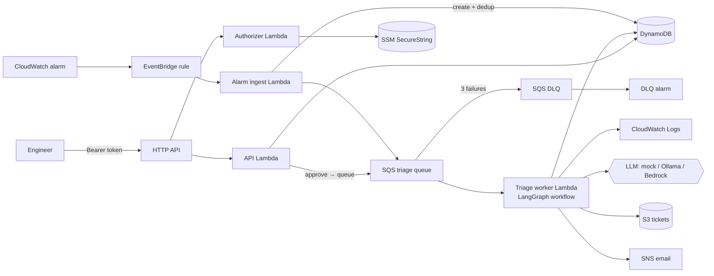

# OpsPilot — AI-assisted cloud incident triage on AWS

OpsPilot receives CloudWatch alarms, gathers evidence, asks an LLM for a diagnosis, and proposes a fix.
A human approves anything that changes infrastructure. It is built on AWS serverless services and fits in the AWS free tier.

> **Design stance:** rules decide, the model advises, a human approves. The LLM never picks the target
> of an action and never executes anything. If the model is down or returns junk, triage still completes.

## What it does

1. A CloudWatch alarm for a managed Lambda function changes to `ALARM`.
2. EventBridge triggers an ingest Lambda, which creates a de-duplicated incident (repeat alerts bump a counter) and queues it on SQS.
3. A worker Lambda runs a **LangGraph** workflow:
   fetch logs → redact secrets → retrieve matching runbooks → diagnose → policy gate.
4. Read-only actions (notify, draft a ticket) run automatically. A mutating action (raise Lambda memory) waits for approval over the REST API.
5. After approval the workflow re-checks policy, executes, and notifies by SNS email.

## Architecture



Workflow states: `RECEIVED → TRIAGING → AWAITING_APPROVAL → APPROVED → EXECUTING → RESOLVED` (or `REJECTED` / `FAILED`).
Every transition is a conditional write, so duplicate or concurrent deliveries cannot double-execute an action.
More detail: [docs/architecture.md](docs/architecture.md) and the [decision records](docs/adr/).

## AWS services used

| Service | Role | Free-tier note |
|---|---|---|
| Lambda (python3.12) | 5 functions: API, authorizer, ingest, worker, demo workload | 1M requests/month |
| API Gateway (HTTP API) | REST surface, throttled 20 rps | 1M calls for 12 months |
| SQS + DLQ | Decouples intake from triage, retries, partial batch failure | 1M requests/month |
| DynamoDB | Incidents, dedup markers (TTL), GSI for "latest" | Provisioned 5/5 stays in the always-free 25 RCU/WCU |
| EventBridge | Alarm state-change rule | Free for AWS events |
| CloudWatch | Alarms, JSON logs, EMF custom metrics | 10 alarms, 10 custom metrics free |
| SNS | Email notifications | 1,000 emails free |
| S3 | Drafted ticket files | 5 GB for 12 months |
| SSM Parameter Store | API token as SecureString | Standard parameters free |
| IAM | One least-privilege role per function | Free |
| Bedrock (optional) | Converse API via LangChain | **Not free** |

Infrastructure is one AWS SAM template ([template.yaml](template.yaml)).

## Design decisions worth reading

- **Policy before AI.** Allowed actions are an enum. Action targets come from the incident record, not from model output.
  Memory changes are clamped to 128–1024 MB and to at most double the current value. Low confidence downgrades to a ticket.
- **Prompt-injection aware.** Logs are untrusted input: they are redacted, wrapped in `<logs>` tags, and the system prompt says never to follow them.
  The sample logs include an injection attempt that the tests prove is ignored.
- **Idempotent by construction.** Compare-and-set status transitions, a dedup marker with TTL, and release-on-crash so SQS retries resume work.
- **Fails safe.** Unparseable or unavailable LLM output falls back to a deterministic heuristic.
- **Dry-run by default.** `ALLOW_MUTATING_ACTIONS=false` until you opt in at deploy time.
- **Boring retrieval.** TF-IDF over four runbooks. A vector database would add cost and moving parts without improving this corpus.
- **Observable.** Structured JSON logs with incident ids and EMF metrics, with no custom metric charges beyond the free 10.

## Repository layout

```
template.yaml            SAM stack (19 resources)
src/opspilot/
  graph.py               LangGraph workflow
  llm.py                 mock | ollama | bedrock behind one interface
  store.py               DynamoDB + in-memory stores
  actions.py             policy and executor
  evidence.py redact.py retrieval.py heuristics.py
  handlers/              Lambda entry points
  demo/workload.py       Lambda that can be told to fail on purpose
  runbooks/              markdown runbooks with front matter
samples/                 incidents and logs for offline runs
tests/                   64 unit tests, no AWS needed
docs/                    architecture and ADRs
```

## Try it offline (no AWS account)

```bash
python -m venv .venv && source .venv/bin/activate      # Windows: .venv\Scripts\Activate.ps1
pip install -r src/requirements.txt -r requirements-dev.txt
export PYTHONPATH=src                                   # Windows: $env:PYTHONPATH="src"
python -m opspilot.cli triage samples/incidents/lambda_oom.json --approve
python -m unittest discover -s tests -t .
```

Sample output:

```
  - evidence: 6 log line(s) kept, 0 redaction(s)
  - runbooks: RB-LAMBDA-OOM(0.3837), RB-GENERAL(0.0959)
  - diagnosis (mock): Lambda function ran out of memory [confidence 0.82]
  - policy: SET_LAMBDA_MEMORY, approval required
  - waiting for human approval
  ...
  - RESOLVED: Raised opspilot-demo-checkout-dev from 128 MB to 256 MB.
```

## Deploy to AWS

Requires AWS CLI, SAM CLI and Docker. Full walkthrough with checks at each step: see the project handbook.

```bash
aws ssm put-parameter --name /opspilot/dev/api-token --type SecureString --value "<generate-a-long-random-token>"
sam build
sam deploy --parameter-overrides NotifyEmail=you@example.com
```

Remove everything with `sam delete`.

## API

| Method | Path | Purpose |
|---|---|---|
| POST | `/incidents` | Create an incident manually |
| GET | `/incidents` | List recent (optional `?status=`) |
| GET | `/incidents/{id}` | Detail and event timeline |
| POST | `/incidents/{id}/approve` | Approve a pending action |
| POST | `/incidents/{id}/reject` | Reject it |

All routes require `Authorization: Bearer <token>`.

## Limitations

- Single tenant, single region, one shared bearer token. A real deployment would use Cognito or IAM auth.
- Only Lambda failure modes are covered, with four runbooks.
- Mock provider is keyword-based; model quality was not benchmarked.
- No tracing (X-Ray) and no dashboards beyond alarms and logs.
- Bedrock needs model access enabled in your account and is billed.

## Testing and CI

64 unit tests cover redaction, retrieval, policy, idempotency, the workflow, handlers and the DynamoDB expressions
(against a fake table that rejects floats and enforces conditions). GitHub Actions runs ruff, the tests, cfn-lint and an offline smoke run.
